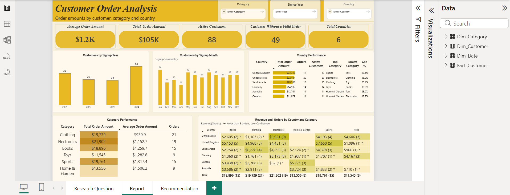
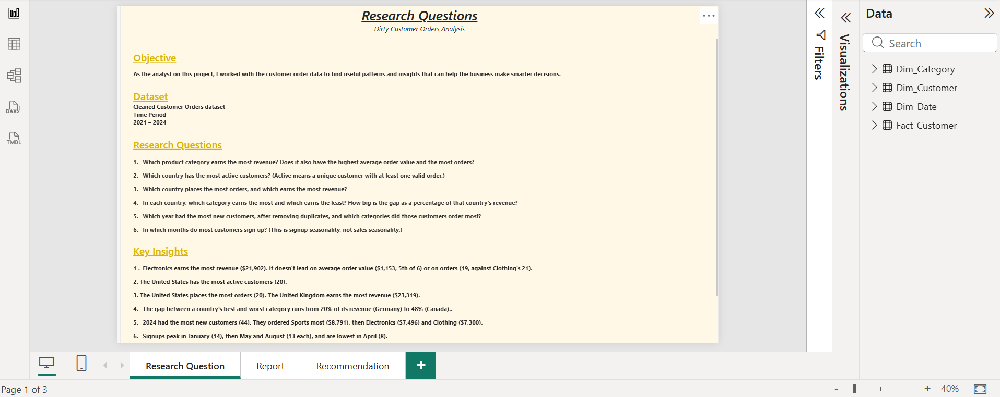
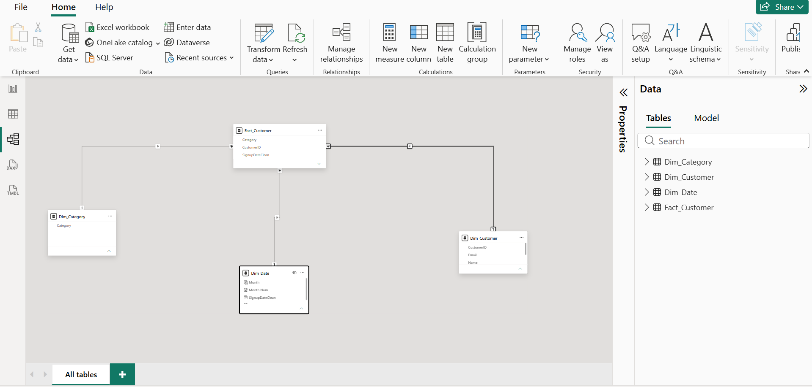
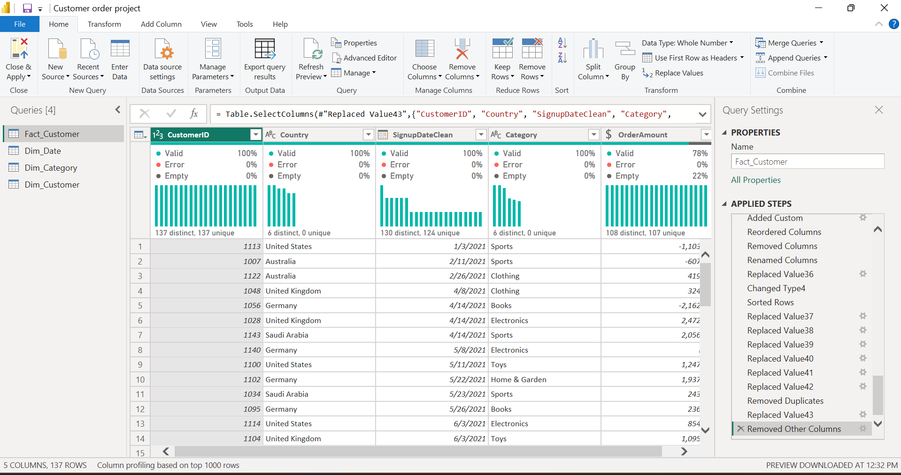
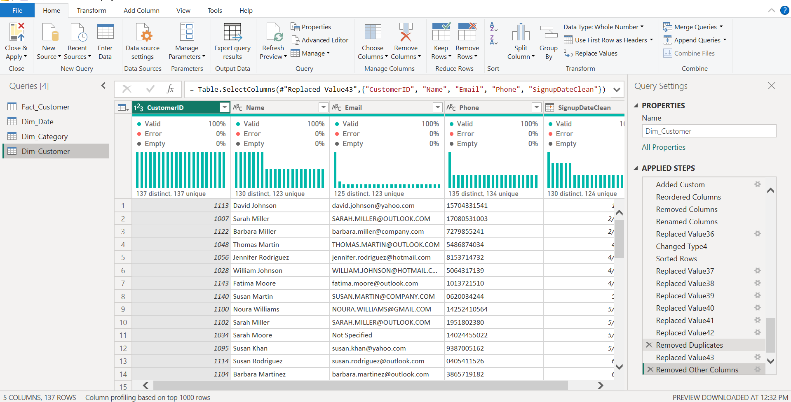
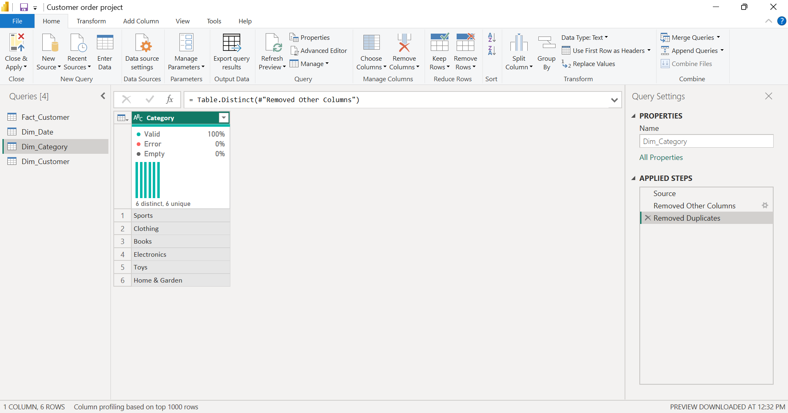
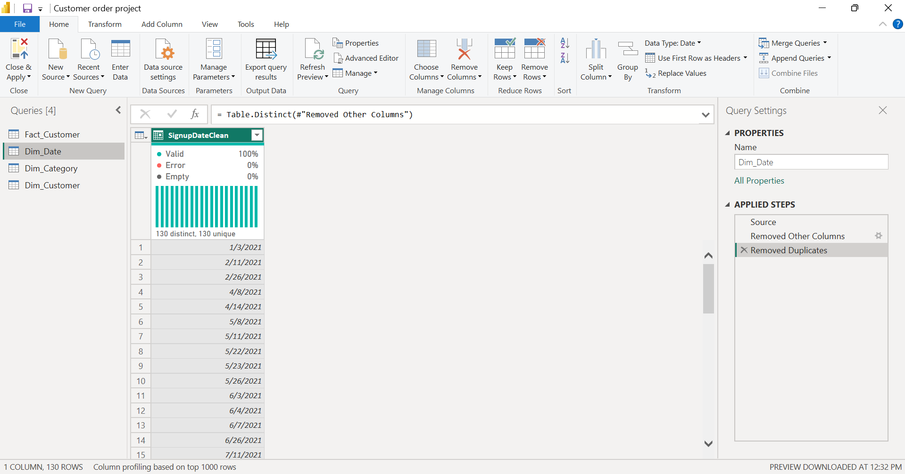
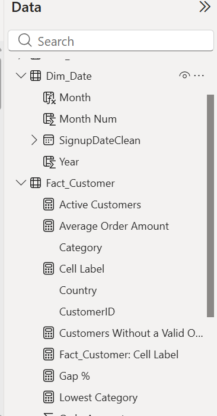
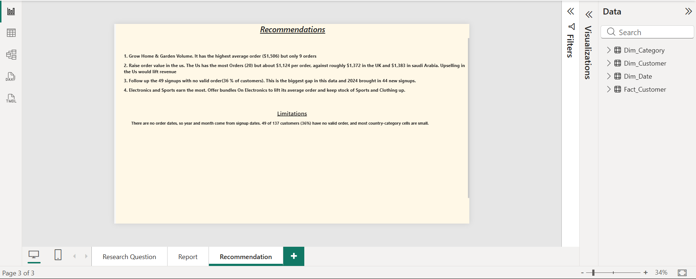

# Customer Order Analysis (Power BI)

I built this project in Power BI to answer six questions about a messy customer orders file. The raw data had duplicate customers and blank, zero and negative order amounts. Most of the work went into cleaning it and deciding what counts as a real order before I built the dashboard.



## Contents

- About the project
- Dataset
- Research questions
- Skills used
- Data model
- Cleaning in Power Query
- What counts as a valid order
- What the cleaning changed
- DAX measures
- The dashboard
- Findings
- Recommendations
- Limitations
- Repository structure
- How to open the project
- About me

## About the project

The goal was to act as the analyst for an online store and answer questions about categories, countries, customers and signups. I also wanted every number to be traceable, so I wrote down each cleaning decision and the rule behind every measure.

The report has three pages: Research Questions, Report (the dashboard) and Recommendation.

## Dataset

- File: dirty_customer_orders.xlsx (in the Raw_Data folder)
- {{RAW_ROWS}} rows in the raw file, 137 customers after removing duplicates
- 6 countries: Australia, Canada, Germany, Saudi Arabia, United Kingdom, United States
- 6 categories: Books, Clothing, Electronics, Home & Garden, Sports, Toys
- Customer signups from 2021 to 2024
- {{SAY WHERE THE DATA CAME FROM AND WHETHER IT IS SYNTHETIC}}

There is no order date in the data, only a signup date. So every year and month result in this project is about when customers signed up, not when they bought.

## Research questions

1. Which product category earns the most revenue? Does it also have the highest average order value and the most orders?
2. Which country has the most active customers? (Active means a unique customer with at least one valid order.)
3. Which country places the most orders, and which earns the most revenue?
4. In each country, which category earns the most and which earns the least? How big is the gap as a percentage of that country's revenue? (Order counts are shown beside revenue, and results based on very few orders are flagged.)
5. Which year had the most new customers, after removing duplicates, and which categories did those customers order most?
6. In which months do most customers sign up? (This is signup seasonality, not sales seasonality.)



## Skills used

- Power Query: removing duplicates, fixing dates and text, handling blank amounts
- Star schema: one fact table and three dimension tables
- DAX: CALCULATE, DISTINCTCOUNT, DIVIDE, VALUES, TOPN, MAXX and MINX
- Writing business rules: what a valid order is, what an active customer is, when a result is too small to trust
- Conditional formatting: colour scales, data bars and a flag for small samples
- Slicers and cross-filtering
- Writing findings and recommendations from the numbers

## Data model

Fact_Customer sits in the middle and connects to three dimension tables. Every relationship is one-to-many, and the filter goes from the dimension table to the fact table.

- Fact_Customer: CustomerID, Category, Country, OrderAmount, SignupDateClean
- Dim_Customer: CustomerID, Name, Email, Phone, SignupDateClean
- Dim_Category: Category
- Dim_Date: SignupDateClean, Year, Month, Month Num



## Cleaning in Power Query

Here is what I fixed in the raw file:

- Removed duplicate customers so each customer appears once ({{DUPLICATES_REMOVED}} rows removed)
- Put the signup dates into one clean column called SignupDateClean
- Cleaned up the country and category text so each value is spelled one way
- Left blank, zero and negative order amounts in the data, and excluded them in the measures instead

I kept the invalid rows on purpose. That way the report can show how many customers never placed a valid order.

Fact_Customer:



Dim_Customer:



Dim_Category:



Dim_Date:



## What counts as a valid order

These three rules are used everywhere in the report.

- Valid order: a row where OrderAmount is greater than 0. Blank, zero and negative amounts do not count.
- Active customer: a unique customer with at least one valid order.
- Low confidence (shown as *): a country and category combination with fewer than 3 valid orders.

Out of 137 customers, 88 have a valid order and 49 do not. Of those 49, 30 have a blank amount and 19 have a zero or negative amount. Each active customer has exactly one valid order, which is why active customers and orders are both 88.

## What the cleaning changed

The same data gives different answers depending on how you treat the invalid rows.

- Total order amount: $77,462 when every non-blank amount is counted, $105,399 with valid orders only
- Average order value: $724 before, $1,198 after
- Top category by revenue: Clothing ($16,287) before, Electronics ($21,902) after

So the answer to the first research question changes. Without the valid order rule, I would have told the business that Clothing is the top category.

## DAX measures

Power BI will sum or average a column for you if you drag it onto a visual. When I did that, the average order value came out wrong because zero and negative amounts were included. So every number in the report comes from a measure I wrote, and each one has the valid order rule built in.

Core measures:

```dax
Total Customers = DISTINCTCOUNT(Fact_Customer[CustomerID])

Total Countries = DISTINCTCOUNT(Fact_Customer[Country])

Total Order Amount =
CALCULATE(SUM(Fact_Customer[OrderAmount]), Fact_Customer[OrderAmount] > 0)

Orders =
CALCULATE(COUNTROWS(Fact_Customer), Fact_Customer[OrderAmount] > 0)

Average Order Amount =
DIVIDE(
    CALCULATE(SUM(Fact_Customer[OrderAmount]), Fact_Customer[OrderAmount] > 0),
    [Orders]
)

Active Customers =
CALCULATE(DISTINCTCOUNT(Fact_Customer[CustomerID]), Fact_Customer[OrderAmount] > 0)

Customers Without a Valid Order = [Total Customers] - [Active Customers]
```

Best and worst category in each country (question 4). Gap % is the best category's revenue minus the worst category's revenue, divided by the country's total revenue.

```dax
Top Category =
VAR t = ADDCOLUMNS(VALUES(Fact_Customer[Category]), "Rev", [Total Order Amount])
RETURN MAXX(TOPN(1, FILTER(t, NOT ISBLANK([Rev])), [Rev], DESC), Fact_Customer[Category])

Lowest Category =
VAR t = ADDCOLUMNS(VALUES(Fact_Customer[Category]), "Rev", [Total Order Amount])
RETURN MAXX(TOPN(1, FILTER(t, NOT ISBLANK([Rev])), [Rev], ASC), Fact_Customer[Category])

Gap % =
DIVIDE(
    MAXX(VALUES(Fact_Customer[Category]), [Total Order Amount])
        - MINX(VALUES(Fact_Customer[Category]), [Total Order Amount]),
    [Total Order Amount]
)
```

The matrix label, which adds the order count and the low confidence star:

```dax
Cell Label =
IF(
    ISBLANK([Total Order Amount]),
    BLANK(),
    FORMAT([Total Order Amount], "$#,##0")
        & " (" & COALESCE([Orders], 0) & ")"
        & IF(COALESCE([Orders], 0) < 3, " *", "")
)
```

Calculated columns in Dim_Date. Month is sorted by Month Num so the chart runs January to December.

```dax
Year = YEAR(Dim_Date[SignupDateClean])

Month = FORMAT(Dim_Date[SignupDateClean], "MMM")

Month Num = MONTH(Dim_Date[SignupDateClean])
```




## The dashboard

Layout: the title and slicers are at the top, then the KPI cards, then the charts, then the tables and the matrix. I used amber and cream with one accent colour, and every visual has a plain title.

KPI cards:

- Average Order Amount: $1,198
- Total Order Amount: $105,399
- Active Customers: 88
- Customers Without a Valid Order: 49
- Total Countries: 6

Charts:

- Customers by Signup Year: 36, 29, 28 and 44 customers for 2021 to 2024
- Customers by Signup Month: labelled as signup seasonality, because there are no order dates

Tables and matrix:

- Category Performance: total order amount, average order amount and orders for each category, with a colour scale on revenue
- Country Performance: revenue, orders, active customers, best category, worst category and gap %, with data bars on revenue
- Revenue by Country and Category: each cell shows revenue with the number of orders in brackets, for example $2,605 (2) *. A star means fewer than 3 valid orders, so the revenue figure is low confidence. The colour gets darker as revenue goes up.

Slicers: Category, Signup Year and Country. Clicking a bar in a chart also filters the cards and tables. Selecting the 2023 bar shows 28 signups, 22 active customers, $31,021 in revenue and an average order of $1,410. Selecting 2024 shows 44 signups, 27 active customers, $30,812 and an average order of $1,141.

## Findings

Q1. Electronics earns the most revenue ($21,902 from 19 orders). It does not lead on average order value, where it is fifth of six at $1,153 and Home & Garden leads at $1,506. It also does not lead on orders, where Clothing has the most with 21.

Q2. The United States has the most active customers (20).

Q3. The United States places the most orders (20), but the United Kingdom earns the most revenue ($23,319). The UK's average order is about $1,372, against about $1,124 in the US.

Q4. The gap between a country's best and worst category goes from 19.9% of revenue in Germany to 47.7% in Canada.

- United Kingdom: Sports is best, Toys is worst, gap 28.1%
- United States: Electronics is best, Clothing is worst, gap 38.9%
- Saudi Arabia: Clothing is best, Toys is worst, gap 25.4%
- Germany: Toys is best, Books is worst, gap 19.9%
- Australia: Home & Garden is best, Toys is worst, gap 23.6%
- Canada: Home & Garden is best, Electronics is worst, gap 47.7%

Most country and category cells have fewer than 5 valid orders, and Canada's gap comes from a single $62 Electronics order. I would treat these gaps as leads, not conclusions.

Q5. 2024 had the most new customers (44, up 57% from 28 in 2023). They ordered Sports most ($8,791), then Electronics ($7,496, the most orders at 8) and Clothing ($7,300). Revenue stayed flat at about $31K in both years, because 17 of the 44 customers from 2024 (39%) have no valid order, against 6 of 28 (21%) in 2023. Revenue per signup dropped from about $1,108 to about $700.

Q6. Signups are fairly even through the year, between 8 and 14 a month. January is highest (14), May and August follow (13 each), and April is lowest (8). November and December have 12 each, close to the average, so there is no clear festive peak.

One more thing I noticed: Sports and Electronics made up about 41% of revenue from 2023 signups and about 53% from 2024 signups. Home & Garden was the top category for 2023 signups ($6,958) and has no valid orders among 2024 signups.

## Recommendations

1. Follow up the 2024 signups first. Signups grew 57% but revenue did not, because 17 of the 44 customers have no valid order.
2. Raise Electronics order value. It earns the most but has a low average order, so bundles and add-ons make sense. Keep Sports and Clothing well stocked, since Sports leads among 2024 signups.
3. Find out why Home & Garden dropped off. It has the highest average order ($1,506), but none of the 2024 signups have a valid order in it.
4. Grow order value in the United States. It has the most orders (20) but a lower average order than the UK and Saudi Arabia.
5. Do not act on small samples yet. Treat anything based on fewer than 3 orders as something to look into, and Canada's 47.7% gap is the clearest example.
6. Fix data capture at the source. Block zero and negative amounts at entry, record refunds in their own field, remove duplicate customers by email, and keep country and category names consistent.



## Limitations

- No order dates. Year and month results use signup dates, so they show when customers joined, not when sales happened. I could not measure sales trends over time.
- 49 of 137 customers (36%) have no valid order. They count as customers but are left out of revenue and order measures.
- Small samples. There are 88 valid orders spread over 36 country and category combinations, so most cells have only a few orders.
- I treated negative amounts as invalid. If they are refunds, a net revenue view would give a lower total, about $77K. This report shows valid sales only..

## Repository structure

```text
Customer_Order_Analysis/
  DAX/
    Dim_Date_DAX.png
    Fact_Customer_DAX.png
  Power_Query/
    Dim_Category.png
    Dim_Customer.png
    Dim_Date.png
    Fact_Customer.png
  Project_Main/
    Customer_Order_Analysis.pbix
  Raw_Data/
    dirty_customer_orders.xlsx
  Screenshot/
    Dashboard.png
    Recommendations.png
    Research_Questions.png
    Star_Schema.png
  README.md
```

## How to open the project

1. Install Power BI Desktop (it is free, Windows only).
2. Download or clone this repository.
3. Open Project_Main/Customer_Order_Analysis.pbix.
4. If Power BI can't find the data, go to Transform data, then Data source settings, then Change Source, and point it to Raw_Data/dirty_customer_orders.xlsx on your computer.